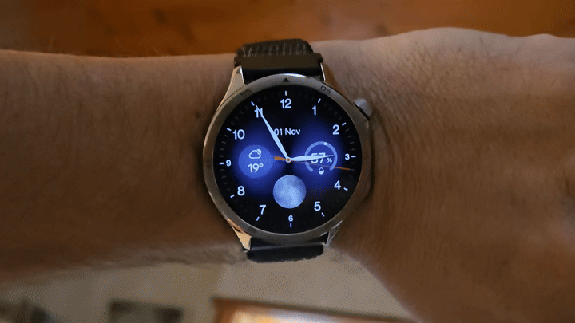

# OnePlus Hands-Only AOD

Just the hands. A black OLED background. Native OnePlus low-power operation preserved.

I tried every official face available on my OnePlus Watch 3. None gave me the simple AOD I wanted: only the hour and minute hands, without a faint background or decorations. This project documents how I modified the native AOD scripts for Serein and Metric Matrix while keeping the official watch face installed.

The regular awake face stays unchanged. No root, firmware flashing or replacement APK is required on the tested configuration. The original hand graphics and anti-burn-in movement are retained by the two recipes provided here.

My measured battery drain with AOD enabled corresponds to approximately **4 to 5 days by extrapolation**. [Measurements and calculation](docs/battery.md).

  
   
  The normal face when awake, just the hands in AOD. Animated preview of the actual watch.

[Watch or download the MP4](https://github.com/Sichroteph/oneplus-hands-only-aod/blob/main/media/demo.mp4).

## Start here

* [Step-by-step guide](docs/tutorial.md)
* [Known configurations and evidence](docs/compatibility.md)
* [How the native access works](docs/protocol.md)
* [Recovery and troubleshooting](docs/recovery.md)
* [Instructions for an AI assistant](AGENTS.md)

This is an experimental knowledge base for people and agents who want to reproduce or adapt the work. It is not a one-click universal watch-face installer.

## Tested scope

OnePlus Watch 3 **OPWWE251**, firmware **OPWWE251_11_A.165**. Two exact stock script revisions are supported. A matching model alone does not establish compatibility. Identify the native resource folder on each watch and compare hashes before writing.

Updates, changing faces or resource resynchronisation may overwrite the modification. Persistence after those events has not been established.

## Use at your own risk

This is a personal, unofficial project, provided as is, without warranty or a support commitment. You are responsible for any modification you make to your device. The author accepts no responsibility for damage, data loss or other consequences of using these instructions or tools. Back up the original resources and retain a verified restoration path.

No OnePlus APK, firmware image, image pack or complete vendor AOD script is distributed here. The recipes apply small edits to files users obtain from their own watches. This project is not affiliated with OnePlus or OPPO.

The tools and documentation are available under the [MIT license](LICENSE). Vendor resources obtained from your watch remain subject to their own terms.
